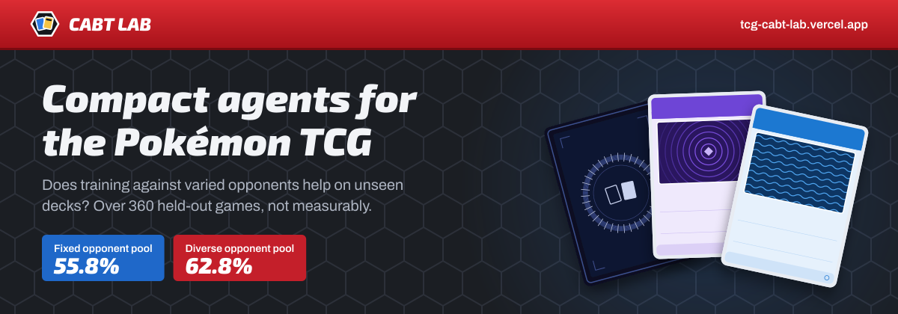

<picture>
  <source media="(prefers-color-scheme: dark)" srcset="assets/banner-dark.svg">
  <source media="(prefers-color-scheme: light)" srcset="assets/banner-light.svg">
  
</picture>

# TCG CABT Lab

[](https://github.com/Builder106/tcg-cabt-lab/actions/workflows/ci.yml)
[](https://www.python.org/downloads/)
[](#license)

TCG CABT Lab studies compact agents for the 60-card Pokemon Trading Card Game. Its first study asks whether training against varied opponents improves performance on deck families the agent has never trained on.

## Project status

The project integrates the CABT 1.0.0 simulation engine (`kaggle-environments==1.33.0`) with verified platform binaries on Linux ARM64, Linux x86_64, and macOS. The pinned card catalog contains 1,431 cards and the attack catalog contains 1,755 attacks; both are checksum-verified. The evaluation framework uses 6 canonical elemental deck families, checks that training, tuning, and held-out test splits are disjoint, and includes reference agents (`RandomAgent`, `FirstAgent`, `HeuristicAgent`).

The first controlled ML study (Milestone 3) is complete. It evaluates an 88-dimensional compact option-scoring MLP policy ($88 \to 32 \to 1$, 2,881 parameters) with He-normal initialization and Adam optimization. Resource benchmarks confirm 0.0285 ms inference latency (<50 ms budget) and 1.8 KB footprint (<512 MiB budget). Checkpoints trained under `fixed-opponent-pool` vs. `diverse-opponent-pool` were evaluated across 360 matched-pair games with reversed seating on frozen held-out test families (`psychic-mewtwo`, `colorless-snorlax`). In the run of record (14 November 2026), pooled win rates were 55.83% (95% CI: [48.53%, 62.89%]) for fixed-opponent training and 62.78% (95% CI: [55.52%, 69.50%]) for diverse-opponent training (delta: +6.95 points, 95% CI: [-3.17, +17.07]). The interval includes zero, so diverse opponent training did not measurably improve play on held-out decks under an equal sample budget. Two earlier runs, made before a fix that lets the imitated teacher play all three training decks, also found no significant difference. A preregistered follow-up with 30 training seeds per arm (7,200 games) found a delta of -1.22 points (95% interval [-3.78, +1.33]) and reports the two pools as equivalent within plus or minus 5 points; see [`docs/analysis-plan.md`](docs/analysis-plan.md) and `experiments/scaled/`. That study copied a teacher that ignores the board, so it could not show an effect. A second preregistered study with a board-reading teacher (30 seeds per arm, 7,200 games) found a delta of +1.40 points (95% interval [-0.67, +3.58]) and again reports equivalence within plus or minus 5 points, although the students now agree with the teacher on only about 61% of held-out decisions; see [`docs/analysis-plan-board.md`](docs/analysis-plan-board.md) and `experiments/board/`. A third preregistered study let the policy learn from play against each pool (REINFORCE, 400 games, starting from the imitation checkpoints) and found a delta of -1.60 points (95% interval [-3.69, +0.61]), equivalent within plus or minus 5 points. The policies barely moved from their start, so this shows no effect at that budget, not no effect; see [`docs/analysis-plan-rl.md`](docs/analysis-plan-rl.md) and `experiments/rl/`.

The public showcase (Milestone 4) is live at <https://tcg-cabt-lab.vercel.app>; its source is in [`web/`](web/). It displays the 360 held-out games as cards that readers can sort by training pool, deck, opponent, seat, ending or checkpoint. Each game can be replayed decision by decision, either from the AI's view or as a spectator. The static Astro site is built from `experiments/`:

```sh
cd web
npm ci
npm run build
npm run preview
```

Vercel deploys the site from GitHub: pushes to `main` go to production and pull requests get a preview. [`web/README.md`](web/README.md) covers the build and deploy settings.

All artwork on the site is original (drawn in Glaxnimate and rendered in Blender); see [`web/design/README.md`](web/design/README.md). Complete metrics and checkpoint weights are recorded in [`experiments/ml-experiment-report.json`](experiments/ml-experiment-report.json).

Read the [research plan](RESEARCH.md), [roadmap](ROADMAP.md), and [showcase brief](docs/showcase.md).

## Usage

Use Python 3.12 and uv 0.12.5:

```sh
uv sync --frozen --group dev
```

### Run the controlled ML experiment

Execute the full training suite and evaluate checkpoints on held-out deck families:

```sh
uv run tcg-cabt-lab experiment --checkpoints-dir experiments/checkpoints --report-out experiments/ml-experiment-report.json
```

### Profile representation and resource budgets

Measure representation extraction latency, dimensionalities, and memory footprints:

```sh
uv run tcg-cabt-lab profile
```

### Train a policy checkpoint

Train a compact policy against an opponent pool variant:

```sh
uv run tcg-cabt-lab train --variant fixed-opponent-pool --seed 11 --steps 400 --out ckpt.json
```

### Run a tournament

Execute a paired tournament across agents and deck families, generating a leaderboard and matchup grid:

```sh
uv run tcg-cabt-lab tournament --pilot --out experiments/baseline-pilot-report.json
```

### Inspect deck family splits

Verify disjointness across training, tuning, and held-out test splits:

```sh
uv run tcg-cabt-lab splits
```

### Run a simulated battle

Simulate a full game between two random agents with reproducible seeds and export the structured game log:

```sh
uv run tcg-cabt-lab battle --seed-p0 11 --seed-p1 22 --bo 1 --out battle.json
```

### Inspect the card catalog

Verify the 1,431 cards in the pinned CABT catalog:

```sh
uv run tcg-cabt-lab catalog
```

### Validate a deck

Validate a 60-card deck and display its composition:

```sh
uv run tcg-cabt-lab deck
```

### Smoke test synthetic selection

Sample choice indices from a standalone observation JSON without starting the simulator:

```sh
uv run tcg-cabt-lab sample examples/selection.json --seed 11
```

The sampler can also be imported with a caller-owned random generator:

```python
from random import Random

from tcg_cabt_lab.baseline import choose_random_action

action = choose_random_action(observation, Random(11))
```

Keep the generator alive across decisions when integrating an agent. The CLI creates a fresh generator for each invocation. Full simulator runs must check that actions are accepted by the pinned engine.

## Current flow

The CLI reads an observation JSON file, validates the requested selection bounds, uses a seeded random selector, and returns a JSON array of choice indices.

## Repository layout

| Path | Contents |
| --- | --- |
| `src/tcg_cabt_lab/` | Feature representations, policy models, training, battle runner, tournament evaluation, and CLI |
| `tests/` | Unit and integration tests for representation, policy, training, battle, deck, catalog, and CLI |
| `examples/` | Synthetic choice request for the smoke test |
| `experiments/` | Frozen study settings, checkpoints with weights provenance, baseline reports, and ML experiment results |
| `RESEARCH.md` | Question, empirical findings, controls, evaluation, data policy, and sources |
| `ROADMAP.md` | Milestones and completion criteria |
| `docs/showcase.md` | Public tournament and match-viewer brief |
| `JOURNAL.md` | Decisions behind the project |

Runtime dependencies include the pinned CABT simulation environment and NumPy. Checkpoint JSON weights and experiment reports are tracked with full provenance.

## License

Project code is licensed under [MIT](LICENSE). CABT, competition inputs, Pokemon assets, datasets, and model weights retain their own terms. The project license does not grant rights to redistribute those materials.
